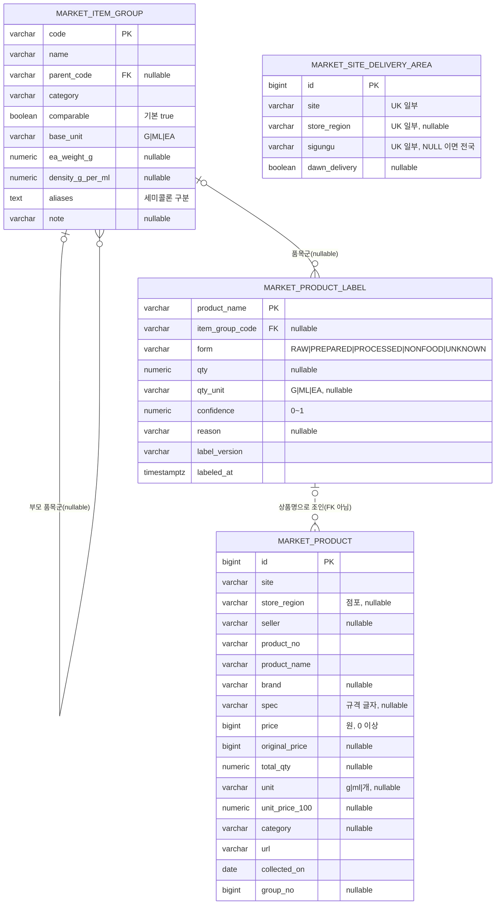

# ERD — 서비스 DB 스키마

> 공유 링크: ERDCloud (MR 뒤 사용자가 추가)

Jira S15P31A308-32 `[DB] DB 스키마 설계·ERD`의 산출물. 마이그레이션 원본은
[`backend/src/main/resources/db/migration/`](../../backend/src/main/resources/db/migration/) 의 V1 ~ V21 이고,
이 문서는 그 최종 상태를 그림으로 보여준다 — 둘이 다르면 SQL 파일이 맞다.

테이블·핵심 컬럼의 출처는 [`docs/plans/3주_개발_계획.md` 5절](../plans/3주_개발_계획.md), 멀티테넌트(한 DB에서 여러 가게를
`store_id`로 구분하는 설계) 규칙은 [ADR-0002](../adr/ADR-0002-multi-tenant-store-scope.md).
2026-10-14 에 미팅·매입 문서 실측·레시피 자동 온보딩·기획 변경을 반영해 표 2개(`purchase_doc`, `purchase_doc_line`)와 칸 여러 개를 더했다.
같은 날 기획 대비 ERD 검토에서 나온 빈칸을 채워 표 4개(`menu_component`, `pos_sale_line`, `menu_alias`, `store_closed_day`)와 칸 여러 개를 더했고,
`menu.pos_name` 은 `menu_alias` 로 옮겼다([DECISIONS #40·#41](../DECISIONS.md)).
5차(같은 날)에 자동 세팅·사진 입고·예측 설계(`docs/plans/2026-10-14_자동세팅_입고_예측_설계.md`, S15P31A308-86 가지 — 이하 "설계") 7절을 반영해
표 1개(`job`)와 칸 여러 개를 더하고 쓰지 않게 된 칸 4개를 지웠다 — 아래 "설계 7절 ↔ 이 스키마 대응표". 여기까지가 V1(표 22개)이다.
표마다 왜 있는지는 아래 "표별 존재 이유와 근거" 절에 있다.
표·칸 설명은 SQL 안에도 `COMMENT ON` 으로 들어 있다 — ERDCloud 에서는 표·칸의 코멘트로 보인다.

| 마이그레이션 | 표 · 칸 변화 |
|---|---|
| V2 | 인덱스만 — `supplier_product (store_id, product_name)` |
| V3 | 인덱스만 — `stock_count` · `purchase_order_item` · `purchase_doc_line` 에 `store_id` 로 시작하는 인덱스, `idx_stock_count_ingredient_time` 삭제 (S15P31A308-159) |
| V4 | 표 `recommendation_run` (S15P31A308-188, ADR-0009, DECISIONS #59) |
| V5 | 전역 표 `market_product` (S15P31A308-232, ADR-0010, #69) |
| V6 | `store.sigungu`, 전역 표 `market_site_delivery_area` + 시드 (S15P31A308-230, ADR-0011, #70) |
| V7 | `store.price_compare` (S15P31A308-205, #48) |
| V8 | 전역 표 `market_item_group` + 시드 · `market_product_label`, `market_product` 인덱스 2개 (S15P31A308-228 · 229, ADR-0012, #71) |
| V9 | `ingredient.storage_location` (S15P31A308-268, #75) |
| V10 | Spring Batch 메타 표 6개 — 그림에 넣지 않음, 아래 목록 (S15P31A308-229, ADR-0014, #76) |
| V11 | 표 `ingredient_category`, `ingredient.category_id` (S15P31A308-273, #77) |
| V12 | `ingredient.category_source` (S15P31A308-274, #78) |
| V13 | `purchase_order_item.auto_received` (S15P31A308-238, #84) |
| V14 | 데이터만 — `market_item_group` 의 `STARCH` 행 `category` 를 '가루'로 (S15P31A308-285). 표 · 칸 변화 없음 |
| V15 | `purchase_doc_line.purchase_order_item_id` + unique 인덱스 `uq_doc_line_order_item` (S15P31A308-301, #86) |
| V16 | `purchase_order.source`(`supplier_id` 는 nullable 로) · `purchase_order_item.unit_price` · `product_url` (S15P31A308-201, #90) |
| V17 | 표 `stock_adjustment` · `store_closing_time` · `push_subscription`, `stock_count.counted_after_close` · `store.last_closing_push_date` (S15P31A308-246, #88 · #92) |
| V18 | 전역 표 `onboarding_replay`(온보딩 저장본, S15P31A308-321, #96) |
| V19 | `onboarding_replay.kind` CHECK 제약에 `ANALYSIS` 추가(분석 결과 저장본, S15P31A308-333, #96) |
| V20 | 가게별 주간 매출 예측 표 `sales_forecast_week` (S15P31A308-267 · 226, #97) |
| V21 | `store.latitude` · `longitude`, 좌표 범위와 쌍 제약 (S15P31A308-226, #97) |
| V25 | `store.address TEXT NULL` — 네이버 플레이스 전체 주소, 배송 시군구와 분리. 기존 가게의 같은 placeId인 최신 유효 SEARCH 후보 주소 보강 (S15P31A308-357, ADR-0023, #115) |

지금 앱 표는 33개다 — 가게 소속 26개 · `store` · `account`(그림 1), 식자재몰 전역 표 4개(그림 2), 온보딩 저장본 전역 표 `onboarding_replay` 1개(그림 없음).
그림에 넣지 않은 표(V10, Spring Batch 6 스키마 그대로): `BATCH_JOB_INSTANCE` · `BATCH_JOB_EXECUTION` · `BATCH_JOB_EXECUTION_PARAMS` · `BATCH_STEP_EXECUTION` · `BATCH_STEP_EXECUTION_CONTEXT` · `BATCH_JOB_EXECUTION_CONTEXT`.

**그림 읽는 법**: 그림 1 에서 `STORE`·`ACCOUNT` 를 뺀 모든 표(26개)에 `store_id` 칸이 있고 `store(id)` 를 가리키는 FK(외래키: 다른 표의 행을 가리키는 칸)다.
그림 2 의 식자재몰 전역 표 4개(`market_product` · `market_site_delivery_area` · `market_item_group` · `market_product_label`)와 `BATCH_*` 표에는 `store_id` 가 없다(ADR-0002 예외 — ADR-0010 · 0011 · 0012 · 0014).
선이 그림을 덮어 읽을 수 없어서 STORE 에서 나가는 선은 그리지 않았다. 선 기호는 `||` 정확히 하나, `|o` 없거나 하나, `o{` 0개 이상. 점선은 FK 없이 값으로 맞추는 관계.

**백엔드(`backend/src/main`)에 넣는 경로가 없는 표**: `pos_sale` · `store_closed_day` 는 시드로만 적재(`ai/src/weglee_ai/seed_sql.py`). `sales_forecast_week` 는 로컬 AI 적재(`ai/src/weglee_ai/sales_forecast/`)로만 들어간다. `pos_sale_line` · `menu_component` 는 시드에도 넣는 경로가 없다.

그림 1 — 가게 표

```mermaid
erDiagram
    ACCOUNT ||--o{ STORE_MEMBER : "소속"
    ACCOUNT |o--o{ RECOMMENDATION : "승인자"

    MENU ||--o{ RECIPE : "쓰인다"
    INGREDIENT ||--o{ RECIPE : "쓰인다"
    INGREDIENT ||--o{ SUPPLIER_PRODUCT : "판매 품목"
    INGREDIENT_CATEGORY ||--o{ INGREDIENT : "카테고리"
    SUPPLIER ||--o{ SUPPLIER_PRODUCT : "공급"
    SUPPLIER_PRODUCT |o--o{ INGREDIENT : "대표 상품(nullable)"
    SUPPLIER_PRODUCT ||--o{ PRICE_HISTORY : "단가 이력"
    MENU ||--o{ POS_SALE : "판매"
    MENU ||--o{ FORECAST : "예측대상"
    INGREDIENT ||--o{ STOCK_COUNT : "실사·검수"
    INGREDIENT ||--o{ STOCK_ADJUSTMENT : "빼기 기록"
    ACCOUNT ||--o{ PUSH_SUBSCRIPTION : "구독"
    INGREDIENT ||--o{ RECOMMENDATION : "추천대상"
    SUPPLIER |o--o{ PURCHASE_ORDER : "수신(식봄 · 쿠팡 발주서는 nullable)"
    PURCHASE_ORDER ||--o{ PURCHASE_ORDER_ITEM : "포함"
    SUPPLIER_PRODUCT ||--o{ PURCHASE_ORDER_ITEM : "주문품목"
    INGREDIENT ||--o{ PURCHASE_ORDER_ITEM : "주문재료"

    SUPPLIER |o--o{ PURCHASE_DOC : "보낸 문서(nullable)"
    PURCHASE_ORDER |o--o{ PURCHASE_DOC : "입고 대사(nullable)"
    PURCHASE_DOC ||--o{ PURCHASE_DOC_LINE : "품목 줄"
    SUPPLIER_PRODUCT |o--o{ PURCHASE_DOC_LINE : "맞춘 상품(nullable)"
    INGREDIENT |o--o{ PURCHASE_DOC_LINE : "맞춘 재료(nullable)"
    PURCHASE_DOC_LINE |o--o{ PRICE_HISTORY : "단가 근거(nullable)"

    MENU ||--o{ MENU_COMPONENT : "세트"
    MENU ||--o{ MENU_COMPONENT : "구성 메뉴"
    MENU ||--o{ MENU_ALIAS : "포스 이름"
    MENU |o--o{ POS_SALE_LINE : "연결 메뉴(nullable)"
    POS_SALE_LINE |o--o{ POS_SALE_LINE : "옵션 줄의 본품(nullable)"
    SUPPLIER_PRODUCT |o--o{ RECOMMENDATION : "추천 상품(nullable)"
    RECOMMENDATION |o--o| PURCHASE_ORDER_ITEM : "주문으로(nullable)"
    JOB |o--o{ PURCHASE_DOC : "처리한 영수증 job(nullable)"
    PURCHASE_ORDER_ITEM |o--o| PURCHASE_DOC_LINE : "입고 확인한 영수증 줄(nullable)"

    STORE {
        bigint id PK
        varchar name
        varchar display_name
        varchar timezone
        jsonb onboarding
        varchar naver_place_id "nullable"
        varchar yogiyo_shop_id "nullable"
        boolean yogiyo_consent "기본 false"
        varchar pos_vendor "nullable"
        varchar pos_store_code "nullable"
        varchar sigungu "시군구, nullable"
        text address "전체 주소, nullable, V25"
        double latitude "위도, nullable (V21)"
        double longitude "경도, nullable (V21)"
        boolean price_compare "기본 true"
        date last_closing_push_date "nullable"
    }
    RECOMMENDATION_RUN {
        bigint id PK
        bigint store_id FK
        date run_date "UK 일부"
        timestamptz started_at
        timestamptz finished_at "nullable"
        int created_count "기본 0"
        int no_order_count "기본 0"
    }
    JOB {
        bigint id PK
        bigint store_id FK
        varchar type "ONBOARDING|RECEIPT"
        varchar status "QUEUED|RUNNING|DONE|FAILED"
        numeric progress "0~1"
        jsonb result_json "nullable"
        text error "nullable"
        timestamptz created_at
        timestamptz updated_at
        timestamptz finished_at "nullable"
    }
    ACCOUNT {
        bigint id PK
        varchar email UK
        varchar password_hash
        varchar name
    }
    STORE_MEMBER {
        bigint id PK
        bigint account_id FK
        bigint store_id FK
        varchar role "OWNER|STAFF"
    }
    MENU {
        bigint id PK
        bigint store_id FK
        varchar name
        varchar kind "MAIN|OPTION|SET"
        boolean active
        numeric price "nullable"
        text description "nullable"
        text photo_url "대표 메뉴 사진 원본 URL, nullable, V24"
        varchar source "NAVER|YOGIYO|POS|MENU_PHOTO"
    }
    MENU_COMPONENT {
        bigint id PK
        bigint store_id FK
        bigint set_menu_id FK
        bigint component_menu_id FK
        numeric qty "0 초과"
    }
    MENU_ALIAS {
        bigint id PK
        bigint store_id FK
        bigint menu_id FK
        varchar pos_name
    }
    STORE_CLOSED_DAY {
        bigint id PK
        bigint store_id FK
        date closed_date
        varchar reason "nullable"
    }
    STORE_CLOSING_TIME {
        bigint id PK
        bigint store_id FK
        smallint day_of_week "1(월)~7(일)"
        time close_time
        timestamptz created_at
        timestamptz updated_at
    }
    PUSH_SUBSCRIPTION {
        bigint id PK
        bigint store_id FK
        bigint user_id FK
        text endpoint UK
        text p256dh
        text auth
        timestamptz created_at
    }
    INGREDIENT {
        bigint id PK
        bigint store_id FK
        varchar name
        varchar unit "EA|G|ML"
        numeric safety_days "N"
        numeric max_order_qty "nullable"
        bigint primary_supplier_product_id FK "nullable"
        boolean price_sensitive
        int shelf_life_days "nullable"
        varchar sourcing_type "GENERIC|DEDICATED"
        varchar kind "BOM|ONE_TO_ONE|CYCLE"
        varchar unit_status "ESTIMATED|CONFIRMED|LOCKED"
        varchar storage_type "FROZEN|AMBIENT|CHILLED|FRESH, CYCLE 만 nullable"
        varchar storage_location "FREEZER|FRIDGE|SHELF|WAREHOUSE"
        bigint category_id FK
        varchar category_source "AUTO|OWNER"
    }
    INGREDIENT_CATEGORY {
        bigint id PK
        bigint store_id FK
        varchar code "기본 11종 코드, 사장님이 만든 것은 nullable"
        varchar name
        int sort_order
        timestamptz created_at
    }
    SUPPLIER {
        bigint id PK
        bigint store_id FK
        varchar name
        varchar channel "KAKAO|PHONE|EMAIL|WEB|MALL, nullable"
        int lead_time_days "nullable"
        int order_cycle_days "R, nullable"
        time cutoff_time "nullable"
        text_array delivery_days "nullable"
        numeric min_order_amount "nullable"
        text message_template "nullable"
        varchar email "nullable"
        numeric shipping_fee "배송비, nullable"
        numeric free_shipping_min "무료배송 최소 금액, nullable"
    }
    SUPPLIER_PRODUCT {
        bigint id PK
        bigint store_id FK
        bigint supplier_id FK
        bigint ingredient_id FK
        varchar product_name
        numeric pack_size "nullable"
        varchar pack_unit "nullable"
        numeric moq "nullable"
        numeric price "nullable"
        numeric base_qty_per_pack "포장 1개당 기준 단위량, nullable"
    }
    RECIPE {
        bigint id PK
        bigint store_id FK
        bigint menu_id FK
        bigint ingredient_id FK
        numeric qty_per_serving
        varchar source "MANUAL|AI|OWNER_CONFIRMED|REGRESSION|FILE"
        numeric confidence "0~1, nullable"
    }
    POS_SALE {
        bigint id PK
        bigint store_id FK
        date sold_date
        bigint menu_id FK
        numeric qty
        varchar raw_menu_name "nullable"
        varchar source "API|EXCEL"
        varchar source_file "nullable"
        varchar channel "DELIVERY|HALL|NONE, UK 일부"
    }
    POS_SALE_LINE {
        bigint id PK
        bigint store_id FK
        timestamptz sold_at
        date sold_date "영업일, UK 일부"
        varchar receipt_no
        int line_no
        bigint parent_line_id FK "옵션 줄의 본품, nullable"
        varchar raw_name
        numeric qty
        numeric amount "nullable"
        bigint menu_id FK "연결 전 nullable"
        varchar source "API|EXCEL"
        jsonb raw "nullable"
        varchar channel "DELIVERY|HALL|NONE"
    }
    STOCK_COUNT {
        bigint id PK
        bigint store_id FK
        bigint ingredient_id FK
        timestamptz counted_at
        numeric qty
        numeric estimated_qty "nullable"
        varchar method "CONFIRMED|CORRECTED|FULL_COUNT"
        boolean counted_after_close "기본 false"
    }
    STOCK_ADJUSTMENT {
        bigint id PK
        bigint store_id FK
        bigint ingredient_id FK
        timestamptz adjusted_at
        numeric qty "양수, 기준 단위"
        varchar reason "DISCARD|SPOILED|DAMAGED|SPILLED|OTHER"
        text memo "nullable"
        numeric before_qty
        numeric after_qty
        text source_text "nullable"
        timestamptz created_at
    }
    FORECAST {
        bigint id PK
        bigint store_id FK
        bigint menu_id FK
        date target_date
        numeric predicted_qty
        varchar model "timesfm, dow_avg 등"
        timestamptz created_at
        varchar channel "DELIVERY|HALL|NONE, UK 일부"
    }
    SALES_FORECAST_WEEK {
        bigint id PK
        bigint store_id FK "UK 일부"
        date week_start "그 주 월요일, UK 일부"
        varchar model "seoulevent-v3 등"
        int pct "평소 주 대비 %"
        varchar reason
        jsonb days "[{date, label, value}]"
        jsonb factors "[{name, note, pct}]"
        text analysis "nullable"
        timestamptz created_at
    }
    RECOMMENDATION {
        bigint id PK
        bigint store_id FK
        bigint ingredient_id FK
        date run_date
        numeric est_stock
        numeric on_order
        numeric lead_time_demand
        numeric safety_stock
        numeric reorder_point
        numeric recommended_qty
        numeric price_ratio "nullable"
        varchar price_level "HIGH|NORMAL|LOW, nullable"
        numeric cycle_days_used "R', nullable"
        text reason "nullable"
        varchar status "PENDING|APPROVED|REJECTED"
        numeric final_qty "nullable"
        bigint decided_by FK "nullable"
        timestamptz decided_at "nullable"
        text reject_reason "nullable"
        date runout_date "소진 예상일, nullable"
        bigint supplier_product_id FK "추천 상품, nullable"
        date next_order_date "다음 주문일, nullable"
        varchar forecast_model "쓴 예측 모델"
        varchar ss_method "STAT|DAYS_N"
    }
    PURCHASE_ORDER {
        bigint id PK
        bigint store_id FK
        bigint supplier_id FK "source 가 SUPPLIER 일 때만, nullable"
        varchar source "SUPPLIER|SIKBOM|COUPANG, 기본 SUPPLIER"
        varchar status "DRAFT|SENT|CANCELLED"
        text message_text "nullable"
        timestamptz created_at
        timestamptz sent_at "nullable"
    }
    PURCHASE_ORDER_ITEM {
        bigint id PK
        bigint store_id FK
        bigint po_id FK
        bigint supplier_product_id FK
        bigint ingredient_id FK
        numeric qty
        date expected_date "nullable"
        numeric received_qty "nullable"
        timestamptz received_at "nullable"
        numeric received_unit_price "nullable"
        timestamptz cancelled_at "안 옴, nullable"
        bigint recommendation_id FK "UK, 수동 주문은 nullable"
        boolean auto_received "기본 false"
        numeric unit_price "포장 1개 단가, nullable"
        varchar product_url "식봄 · 쿠팡 줄만, nullable"
    }
    PURCHASE_DOC {
        bigint id PK
        bigint store_id FK
        bigint supplier_id FK "nullable"
        varchar doc_type "10종, 아래 설계 메모, nullable"
        date doc_date "nullable"
        numeric total_amount "nullable"
        varchar file_path "nullable"
        varchar parse_status "PENDING|PROCESSING|PARSED|CONFIRMED|FAILED"
        bigint purchase_order_id FK "nullable"
        timestamptz created_at
        bigint job_id FK "nullable"
        jsonb ocr_json "nullable"
        varchar kind "PAST|RECEIVE, nullable"
        text error "nullable"
    }
    PURCHASE_DOC_LINE {
        bigint id PK
        bigint store_id FK
        bigint doc_id FK
        int line_no
        varchar raw_name
        numeric qty "nullable"
        varchar unit "nullable"
        numeric unit_price "nullable"
        numeric amount "nullable"
        bigint supplier_product_id FK "nullable"
        bigint ingredient_id FK "nullable"
        numeric confidence "0~1, nullable"
        varchar status "PENDING|CONFIRMED|IGNORED"
        jsonb raw "nullable"
        timestamptz created_at
        bigint purchase_order_item_id FK "UK, nullable"
    }
    PRICE_HISTORY {
        bigint id PK
        bigint store_id FK
        bigint supplier_product_id FK
        numeric price
        varchar unit
        timestamptz observed_at
        varchar source "RECEIVE|MANUAL|MARKET|DOC"
        bigint doc_line_id FK "nullable"
    }
```

그림 2 — 식자재몰 전역 표 (`store_id` 없음). `market_site_delivery_area` 는 `site` · `store_region` 글자로 `market_product` 와 맞추고 FK 는 없다.

## 표별 존재 이유와 근거

앱 표 33개 각각 무엇을 담는지, 왜 있어야 하는지, 근거가 어디 적혀 있는지. 파일 위치는 저장소 기준 `파일:줄`.
저장소 밖 자료(팀원이 열 수 없는 곳)는 이름과 절만 적고, 필요한 숫자는 여기에 옮겨 둔다.

- **계획서** = `docs/plans/3주_개발_계획.md`
- **위글리 미팅 기록 2026-10-07 (저장소 밖)** — 사장님 미팅 메모
- **매입 문서 실측 (저장소 밖)** — 팀 실험 폴더의 `poc/feasibility.py:55-66`(문서 10종과 사장님 사용 빈도 예상 순위, 사용자 제공),
  `reports/poc_docs.md:45-47`(문서 종류별로 단가가 읽히는지 라벨 집계)
- **자동 온보딩 가능성 문서 (2026-10-14, PM·FE)** — 레시피를 메뉴 사진으로 자동 생성하는 방법 조사. 저장소 밖
- **2026-10-14 기획 변경** — 사용자(팀) 결정: "포스기 API 로 메뉴 판매량 확인 + 메뉴 사진으로 레시피 추정 +
  사장님 검수('이만큼 남은 거 맞나요?') → 발주 시기 자동 예측"
- **2026-10-14 기획 대비 ERD 검토** — 기획대로 돌리면 계산이 틀어지거나 저장이 안 되는 자리 검토(A 그룹: 옵션·세트, 포스 원본 줄, 별칭,
  앱 밖 구매 입고, 발주 취소, 휴무일 / B 그룹: 추천→주문 추적, 추천 상품, 배송비, 상품명 unique, 다음 주문일). 결정은 [DECISIONS #40·#41](../DECISIONS.md)
- **설계** = `docs/plans/2026-10-14_자동세팅_입고_예측_설계.md`(PM·FE, 2026-10-14). 아직 develop 에 없고 `docs/auto-onboarding-design-S15P31A308-86` 가지에 있다

### store
- **무엇을 담나**: 가게 1곳 = 테넌트(서비스를 나눠 쓰는 손님 단위) 1개. 이름·시간대·설정 완료 체크리스트, 네이버 플레이스 ID·요기요 가게 ID·요기요 수집 동의, 포스기 업체·매장 코드.
- **왜 필요한가**: 다른 가게도 같은 서비스를 쓰게 하려면 모든 데이터가 가게 단위로 나뉘어야 한다. 가게 이름·마감 같은 값을 코드에 박지 않고 여기 둔다.
  `naver_place_id`·`yogiyo_shop_id` 는 자동 세팅(온보딩)이 메뉴·설명·사진을 가져올 곳, `yogiyo_consent` 는 사장님이 요기요 수집에 동의했는지(기본 false),
  `pos_vendor`·`pos_store_code` 는 포스기 API 로 어느 매장 판매를 가져올지.
  `sigungu`(V6)는 "<시도> <시군구>" 글자 그대로의 가게 위치로 `market_site_delivery_area.sigungu` 와 맞춰 배달 안 되는 판매처를 뺀다(NULL 이면 판정하지 않음).
  `address`(V25)는 서버가 수집한 선택 네이버 플레이스의 전체 주소다. 더보기 표시에 쓰며 배송 시군구를 대체하지 않는다([ADR-0023](../adr/ADR-0023-store-address.md)).
  `price_compare`(V7)는 발주 화면 품목 상세에 식자재몰 최저가를 보일지(저장 · 조회만).
  `latitude`·`longitude`(V21)는 가게 좌표 — 이번 주 매출 예측이 가게 반경 1km 상권만 보게 한다(둘 다 비면 `sigungu` 의 구 단위, 함께 비거나 함께 찬다).
- **근거**: 계획서:23(첫날부터 멀티 테넌트), 계획서:242(칼럼), 계획서:258(가게별 값은 store 행에) ·
  `docs/adr/ADR-0002-multi-tenant-store-scope.md:15` · 설계 2·7절 · 2026-10-14 기획 변경(포스기 API) · ADR-0011 · [DECISIONS #48 · #70](../DECISIONS.md).

### job
- **무엇을 담나**: 몇 분 걸리는 작업 하나 — 온보딩 분석(`ONBOARDING`) 또는 영수증 인식(`RECEIPT`). 상태(`QUEUED` 대기 → `RUNNING` → `DONE` / `FAILED`),
  진행률 `progress`(0~1), 결과 `result_json`, 실패 사유 `error`, 만든·바뀐·끝난 시각.
- **왜 필요한가**: 수집·LLM 호출·OCR 은 몇 분씩 걸려 요청 한 번에 끝나지 않는다. 화면이 2초마다 진행률을 물어볼 대상이 필요하다.
  온보딩 결과(메뉴·재료·레시피·조합 규칙·질문)는 사장님이 확정하기 전까지 `result_json` 에만 두고, 확정 때 recipe 행으로 펼친다(설계 2.4).
  서버가 재시작되면 `RUNNING` 인 job 은 `FAILED` 로 바꾸고 화면에 재시도 버튼을 띄운다(설계 7절). 영수증 job 이 처리한 문서는 `purchase_doc.job_id` 로 가리킨다.
- **근거**: 설계 2.4절(분석 job 단계와 진척도) · 4.2절(영수증 처리 흐름) · 7절(job 신규) · 지라 92(job 실행기)·111(영수증 job).

### account
- **무엇을 담나**: 로그인 계정(이메일·비밀번호 해시·이름).
- **왜 필요한가**: 로그인한 사람이 어느 가게 데이터를 볼 수 있는지 정하는 출발점. 추천을 누가 승인했는지(`recommendation.decided_by`)도 여기를 가리킨다.
- **근거**: 계획서:240 · 계획서:44(계정·가게) · ADR-0002:15.

### store_member
- **무엇을 담나**: 계정과 가게의 연결, 역할(OWNER 사장님 / STAFF 직원).
- **왜 필요한가**: 한 계정이 여러 가게, 한 가게에 여러 계정(N:N). 나중에 표를 쪼개면 다 뜯어야 해서 처음부터 둔다.
- **근거**: 계획서:241 · ADR-0002:15(본문은 `account_store` 라는 이름 — 같은 표).

### menu
- **무엇을 담나**: 가게가 파는 메뉴. 종류(`kind`: 일반 `MAIN` / 유료 추가 옵션 `OPTION` / 세트 `SET`), 판매가, 수집한 설명(`description`), 가져온 곳(`source`: NAVER·YOGIYO·POS·MENU_PHOTO).
  포스기에 찍히는 이름은 여러 개일 수 있어 `menu_alias` 로 옮겼다(예전 `pos_name` 칸은 지움).
- **왜 필요한가**: 판매량 × 레시피 = 재료 소비량(계획서 4.1)의 출발점. "마늘 추가" 같은 유료 옵션도 `kind='OPTION'` 메뉴로 두고 레시피 줄을 달아야
  소비량에 잡힌다 — 빠지면 추천이 모자라고 레시피 역산 보정이 옵션 몫을 본품 레시피 탓으로 잘못 배운다.
  `price` 는 메뉴판 OCR(사진 속 글자 읽기)과 네이버 플레이스 메뉴를 이름·가격으로 맞출 때 쓴다.
  `description` 은 LLM 구성 추출의 입력(사진이 있는 메뉴는 설명과 함께 사진도 보낸다, 묶음당 사진 원본 합 10MiB 까지 — DECISIONS #82), `source` 는 DB 기본값 없이 넣는 쪽이 명시한다.
- **근거**: 계획서:243 · 계획서:121-127(4.1 이론 소비량) · 자동 온보딩 가능성 문서 "권장 파이프라인" 1·2단계 · 설계 2.3·2.4·7절 ·
  2026-10-14 기획 대비 ERD 검토 A1·A3.

### menu_component — 넣는 경로 없음
- **무엇을 담나**: 세트 메뉴 하나가 어떤 메뉴 몇 개로 이뤄지는지(세트 메뉴, 구성 메뉴, 개수).
- **왜 필요한가**: 세트가 팔리면 구성 메뉴의 레시피로 풀어야 재료 소비량이 맞는다. 세트에 레시피를 따로 다는 대신 구성으로 적는다.
  고르는 구성(사이드·음료 선택)은 여기 넣지 않고 포스 원본 줄(`pos_sale_line`)의 옵션 줄로 받는다. DB 가 막는 것은 자기 자신을 바로 넣는 것과 개수 0 이하뿐이다. `set_menu_id` 가 `kind='SET'` 인지, 세트끼리 서로 담는 고리(A→B→A)는 서버가 검사한다.
- **근거**: 계획서:121-127(4.1 판매 × 레시피) · 2026-10-14 기획 대비 ERD 검토 A1 · [DECISIONS #40](../DECISIONS.md).

### menu_alias
- **쓰기 경로**: 백엔드에 INSERT·save 하는 코드가 없다 — **시드로만 적재**. (`menu_alias` 는 메뉴를 지울 때 DELETE 만 한다) 읽는 코드: 소비량·예측·재고 추정·메뉴 서비스.
- **무엇을 담나**: 포스기에 찍히는 이름(`pos_name`)과 그 이름이 가리키는 우리 메뉴.
- **왜 필요한가**: 포스에 같은 메뉴가 여러 이름으로 찍힐 수 있는데(오타·옛 이름·업체별 표기) 예전 `menu.pos_name` 은 이름 하나뿐이었다.
  가게 안에서 한 포스 이름은 한 메뉴에만 연결된다((store_id, pos_name) unique). 포스 원본 줄의 `raw_name` 을 메뉴로 연결할 때 쓴다.
- **근거**: 계획서:243(`pos_name` 은 엑셀 원본 이름 — 이것을 별칭 표로 옮김) · 2026-10-14 기획 대비 ERD 검토 A3 · [DECISIONS #40](../DECISIONS.md).

### store_closed_day — 시드로만 적재
- **무엇을 담나**: 가게가 쉰 날(날짜, 이유).
- **왜 필요한가**: 요일 평균 예측(TimesFM 값이 없을 때 쓰는 대체값, DECISIONS #24)이 "최근 4주 같은 요일 평균, 휴무일 제외" 인데, 휴무일 표가 없으면 판매 0 인 날과 쉰 날을 구분할 수 없어 평균이 낮게 나온다.
- **근거**: 계획서:145(4.3 휴무일 제외) · [DECISIONS #24](../DECISIONS.md)(#4 를 바꾼 결정) · 2026-10-14 기획 대비 ERD 검토 A6.

### ingredient
- **무엇을 담나**: 재료. 기준 단위(`unit`: EA·G·ML)와 그 상태(`unit_status`), 재료 종류(`kind`: BOM·ONE_TO_ONE·CYCLE), 보관 방식(`storage_type`),
  안전재고 배수 N(소비 이력 28일 미만·주기형의 `DAYS_N` 식에서만 씀, DECISIONS #28), 최대 발주량, 대표 거래처 상품, 가격 연동 켬/끔, 유통기한, 범용/전용 구분.
- **왜 필요한가**: 추천은 재료 단위로 나온다(오늘 파스타면 몇 g). `sourcing_type` 은 미팅에서 확인된 상품 구분 —
  범용(기성품, 업체·가격 자주 바뀜. 식봄·쿠팡 가격 비교(DECISIONS #37) 대상 후보 — #37 에서 이 칸을 쓸지는 조사 S15P31A308-122 뒤 결정)과 전용(가게 전용 제휴품, 카톡 직거래).
  `kind` 가 소진 계산식을 고른다(BOM = 판매 × 1인분, 1:1 = 판매 개수, 주기형 = 입고 기록으로만). `unit_status` 는 추정 단위가 사람 확인 없이 굳지 않게 하고(입고 기록이 생기면 `LOCKED`),
  `storage_type` 은 안전재고 z·유통기한·가격 연동(`price_sensitive`: 신선 false, 냉동·상온 true) 기본값을 고르는 기준이다.
  BOM·1:1 은 `storage_type` 이 필수이고 주기형(CYCLE)만 비워도 된다(표 제약 `ck_ingredient_storage_type_required`, 7차).
  `storage_location`(V9)은 재료 탭 그림에서 재료를 놓는 자리(냉동·냉장·선반·창고)로, 계산에는 쓰지 않는다 — 기본값 규칙은 아래 설계 메모.
  `category_id`(V11)는 재료 탭에서 재료를 걸러 보는 카테고리(같은 가게의 `ingredient_category`)로, 역시 계산에는 쓰지 않는다 — 아래 설계 메모.
  `category_source`(V12)는 그 카테고리를 자동 분류가 붙였는지(`AUTO`) 사장님이 골랐는지(`OWNER`) — 자동 분류는 `AUTO` 만 다시 분류한다.
- **근거**: 계획서:244 · 계획서:151-163(4.4 발주 판단의 N, 안전재고 식은 [DECISIONS #28](../DECISIONS.md)·설계 5.3 이 바꿈) · 계획서:199-223(4.8 가격 연동·유통기한 상한) ·
  위글리 미팅 기록 2026-10-07 (저장소 밖) 2절 "거래처 구조" 표(범용상품 / 전용상품), 3절 "사장님 니즈"(범용상품은 채널별 시세를 추적해 가장 싼 곳을 알려 주면 좋겠다 — 3주 범위는 [DECISIONS #37](../DECISIONS.md) 대로 식봄·쿠팡 두 곳만) · 설계 3·3.1·4.1·5.3·5.5·7절 · 지라 96·101.

### ingredient_category
- **무엇을 담나**: 가게별 재료 카테고리(V11, S15P31A308-273). 이름, 기본 11종이면 그 코드(`code`: MEAT · SEAFOOD · VEGETABLE · FRUIT · EGG_DAIRY · GRAIN_NOODLE ·
  TOFU_BEAN · SAUCE · PROCESSED · BEVERAGE · OTHER), 화면 순서. 사장님이 만든 카테고리는 `code` 가 NULL.
- **왜 필요한가**: 재료 탭의 냉장고·선반·창고 그림 안에 재료가 글자로만 늘어서면 읽기 어렵다(2026-11-06 E2E QA). 육류·채소·과일·소스처럼 걸러 보려면
  재료마다 카테고리가 있어야 하고, 사장님이 카테고리를 만들고 지울 수 있어야 해서 enum 칸이 아니라 가게별 표다. `OTHER`(기타)는 가게마다 반드시 1개 —
  지우거나 이름을 바꾸지 못하고, 카테고리를 지우면 그 재료는 기타로 옮긴다. 기본 목록의 정본은 `DefaultIngredientCategory`(Java)이고 V11 의 VALUES 는 복사본.
- **근거**: [DECISIONS #77](../DECISIONS.md) · [분류 기준](../plans/2026-11-06_재료_카테고리_분류_기준.md) · 지라 273 (자동 분류 274 · CRUD 275).

### supplier
- **무엇을 담나**: 거래처. 주문 채널, 리드타임 L, 발주 주기 R, 마감 시각, 배송 요일, 최소 주문 금액, 주문 메시지 템플릿, 배송비, 무료배송 최소 금액.
- **왜 필요한가**: 발주점·발주량 계산에 L·R 이 들어가고(4.4·4.5), 주문 메시지를 거래처별로 만든다(4.7).
  채널 `MALL` 은 식봄·쿠팡 같은 온라인 식자재몰 — 미팅에서 주 거래처가 하루 배송 식자재몰로 확인됐다.
  `shipping_fee`·`free_shipping_min` 은 가격을 비교할 때 배송비가 빠지면 결론이 뒤집혀 둔 칸이다(2026-10-07 미팅). 3주 범위 가격 비교(DECISIONS #37: 같은 재료를 식봄·쿠팡 두 곳만)에서 쓸지는 조사(S15P31A308-122) 뒤 정한다.
  `channel`·`lead_time_days`·`order_cycle_days` 는 비어도 된다 — 영수증으로 처음 생긴 거래처는 모르고, 발주 계산이 그 값을 쓸 때 화면이 사장님께 묻는다(설계 6절).
- **근거**: 계획서:246 · 계획서:151-173(4.4·4.5) · 계획서:185-197(4.7) · 위글리 미팅 기록 2026-10-07 (저장소 밖) 1절(채널: 식봄·쿠팡·카톡), 2절(쏙·식봄·쿠팡 위주) · 설계 6절.

### supplier_product
- **무엇을 담나**: 거래처가 파는 상품 하나. 어느 재료인지, 포장 크기·단위, 포장 1개가 재료 기준 단위로 얼마인지(`base_qty_per_pack`, 대파 1단 → 1000), 최소 주문량(MOQ), 현재 단가.
- **왜 필요한가**: 발주량을 MOQ 이상·포장 단위 배수로 올리는 데 쓴다(4.5). 같은 재료를 여러 거래처가 팔 수 있다. 식봄·쿠팡 가격 비교(DECISIONS #37)에 이 표를 쓸지는 조사(S15P31A308-122) 뒤 정한다.
  한 거래처 안에서 같은 상품명은 한 줄이다((supplier_id, product_name) unique) — 매입 문서 줄에서 상품을 이름으로 찾는다.
  처음엔 비어 있고 사장님이 확인한 영수증 매칭이 쌓여 상품명 → 재료 사전이 된다(설계 4.2). 그래서 영수증으로 처음 생긴 상품은 포장 크기·단위·MOQ·단가를 몰라도 받는다(설계 6절).
- **근거**: 계획서:247 · 계획서:165-173(4.5 발주량) · 위글리 미팅 기록 2026-10-07 (저장소 밖) 1절 "채널마다 가격이 달라서" · 설계 3·4.2·6절.

### recipe
- **무엇을 담나**: 메뉴 1인분에 재료가 얼마나 들어가는지(재료 기준 단위), 그 양의 출처(사장님 입력·AI 추정·사장님 확인·역산 보정·레시피 파일 `FILE`), AI 확신도.
  설계의 `recipe.estimated` 는 `source='AI'` 로 읽는다. 주기형(`CYCLE`) 재료엔 줄을 만들지 않는다(서버가 검사, 설계 4.1).
- **왜 필요한가**: 이론 소비량(4.1)과 예측 소비량(4.3)의 곱하는 값. 사장님이 소스 레시피는 줄 수 없다고 했고(정량만 가능),
  레시피를 사진 AI 로 추정 → 확신 낮은 것만 질문 → 운영 중 역산으로 고쳐 가므로, 양이 어디서 왔는지와 얼마나 믿을 만한지 남겨야 한다.
- **근거**: 계획서:245 · 계획서:121-127(4.1), 139-149(4.3) · 위글리 미팅 기록 2026-10-07 (저장소 밖) 4절 "데이터 관련"(소스 레시피 제공 불가, 정량 있음) ·
  자동 온보딩 가능성 문서 "권장 파이프라인" 3·5·6단계 · 2026-10-14 기획 변경(메뉴 사진으로 레시피 추정).

### pos_sale — 시드로만 적재
- **무엇을 담나**: 날짜·메뉴·채널(`channel`: 배달 `DELIVERY` / 홀 `HALL` / 구분 없음 `NONE`)별 하루 판매 수량 합계. 어디서 들어왔는지(포스기 API / 엑셀). 원본 줄(`pos_sale_line`)이 있으면 그것을 하루·메뉴로 합친 요약이고, 엑셀 합계만 받는 가게는 직접 넣는다.
- **왜 필요한가**: 소비량 계산(4.1)과 예측(TimesFM 야간 배치, 오늘자 값이 없으면 최근 4주 같은 요일 평균 — DECISIONS #24)의 원재료. 2026-10-14 기획 방향이 포스기 API 연동이라 받을 칸으로 `source` 를 미리 두고, API 로 들어올 줄은 파일 이름이 없다.
  3주 안의 입력은 여전히 포스 엑셀 업로드다([DECISIONS #3](../DECISIONS.md), 칸만 미리 둔다는 것은 #39).
- **근거**: 계획서:249 · 계획서:121-149(4.1·4.3) · 위글리 미팅 기록 2026-10-07 (저장소 밖) 4절(포스기 API 연동 — 사장님 확인 후 연락) · 2026-10-14 기획 변경(포스기 API 로 판매량 확인) · [DECISIONS #40](../DECISIONS.md).

### pos_sale_line — 넣는 경로 없음
- **무엇을 담나**: 포스기에서 받은 판매를 영수증 한 줄씩 그대로. 판매 시각, 영수증 번호·줄 번호, 옵션 줄이면 붙은 본품 줄(`parent_line_id`),
  포스에 찍힌 이름, 수량·금액, 연결된 메뉴(연결 전이면 비어 있음), 들어온 경로, 포스 원본 한 줄(JSON), 판매 채널(`channel`, unique 에는 안 넣음).
- **왜 필요한가**: 하루 합계(`pos_sale`)로 합치면 "마늘 추가" 가 어느 메뉴에 붙었는지가 사라지고 되살릴 수 없다. 또 `pos_sale.menu_id` 는 필수라
  아직 메뉴와 연결 안 된 포스 이름은 저장할 곳이 없었다 — 여기서는 `menu_id` 를 비워 두고 받는다. 0원 옵션(빼기)·면 변경·곱빼기 계산 규칙은
  포스 형식을 아직 몰라서 넣지 않았고, 형식을 알게 되면 이 원본 줄로 다시 계산한다. 같은 영업일·같은 영수증·같은 줄은 한 번만 들어간다((store_id, sold_date, receipt_no, line_no) unique — 영수증 번호를 날마다 다시 매기는 포스기 때문에 영업일 `sold_date` 를 넣었다).
- **근거**: 2026-10-14 기획 대비 ERD 검토 A2·A3 · 2026-10-14 기획 변경(포스기 API 로 판매량 확인) · [DECISIONS #40](../DECISIONS.md)(2차의 "건별 원본 판매는 저장하지 않는다" 를 뒤집음).

### stock_count
- **무엇을 담나**: 재료 실제 양을 확인한 기록. 사장님이 확정한 양, 그때 화면에 보여 준 추정치, 확인 방식(맞아요 / 아니요 실제는 N / 직접 다 셈).
- **왜 필요한가**: 추정 재고(4.2)의 최종 보정 기준점이 마지막 확인량이다. 검수 사이 앱 밖 입고는 확인된 입고(`kind='RECEIVE'`) 매입 문서의 확인된 줄로 더한다(아래 "입고 규칙").
  기획 변경으로 사장님이 매번 다 세는 대신 "이만큼 남은 거 맞나요?" 에 답하게 됐고, 추정치 대 실제 답이 쌓여야 레시피 역산 보정을 할 수 있다.
- **마감 확인 실사**(`counted_after_close=true`, #92): 그날 판매가 끝난 뒤의 값이라 추정 재고는 다음 날 판매부터 뺀다. 기존 실사는 영업 시작 전 값.
- **근거**: 계획서:250 · 계획서:129-137(4.2 추정 재고) · 2026-10-14 기획 변경(사장님 검수) · 자동 온보딩 가능성 문서 "권장 파이프라인" 6단계(운영 중 역산) · [DECISIONS #41](../DECISIONS.md).

### stock_adjustment
- **무엇을 담나**: 판매 없이 사라진 재고(빼기 기록). 뺀 양(기준 단위), 사유 5종(폐기 · 상함 · 파손 · 쏟음 · 기타), 메모, 빼기 전 · 뒤 추정 재고, 자유 입력 원문.
- **왜 필요한가**: 버린 재고를 기록할 길이 없어 추정 재고가 실제보다 많게 남았다. 추정 재고는 마지막 실사 이후의 빼기 합을 뺀다. 손실을 추정하지 않고 사장님이 말한 값만 넣는다(#30 유지).
- **근거**: [DECISIONS #88 · #92](../DECISIONS.md) · S15P31A308-246 · 252.

### store_closing_time
- **무엇을 담나**: 요일별 영업 종료 시각(요일마다 한 줄, 월=1 … 일=7). 종료가 자정을 넘으면 영업을 시작한 요일 줄에 넣는다.
- **왜 필요한가**: 마감 확인 웹 푸시를 그 시각에 보낸다. 줄이 없는 요일(휴무 · 미설정)은 보내지 않는다. 같은 날 두 번 보내지 않게 `store.last_closing_push_date` 를 쓴다.
- **근거**: [DECISIONS #88](../DECISIONS.md) ① · S15P31A308-246 · 248 · 323.

### push_subscription
- **무엇을 담나**: 브라우저 · 기기 하나의 웹 푸시 구독(endpoint unique, 암호화 키 `p256dh` · `auth`), 구독한 계정.
- **왜 필요한가**: 마감 확인 알림만 웹 푸시로 보낸다(#35 의 예외). 푸시 서버가 404 · 410 을 주면 지운다.
- **근거**: [DECISIONS #88](../DECISIONS.md) · S15P31A308-246 · 248.

### forecast
- **무엇을 담나**: 메뉴별 날짜별 채널별 예측 판매량과 어느 모델이 냈는지(`'timesfm'`, `'dow_avg'` 등).
- **왜 필요한가**: 예측 vs 실제를 비교해 정확도를 평가한다(`GET /forecast/accuracy`). 모델을 바꿔도 결과를 나란히 남긴다 — TimesFM 과 요일 평균을 둘 다 저장한다(DECISIONS #24).
  배달·홀을 따로 예측해 합산하므로 `channel` 이 unique 에 들어간다(설계 5.2).
- **근거**: 계획서:251(평가용) · 계획서:139-149(4.3 예측) · 계획서:294(API) · 설계 5·5.2·7절.

### recommendation
- **무엇을 담나**: 하루 한 재료 한 건의 발주 추천. 계산 근거 숫자(추정 재고·입고 예정·리드타임 수요·안전재고·발주점), 가격 조정 근거, 사장님 결정, 소진 예상일,
  사라고 한 상품, 다음 주문일, 쓴 예측 모델(`forecast_model`)과 안전재고 식(`ss_method`: 통계식 `STAT` / 7일 평균 × N일 `DAYS_N`).
- **왜 필요한가**: 제품의 중심 — "오늘 무엇을 얼마나 주문할지"와 그 이유를 보여 주고 승인·수정·거절을 받는다. `runout_date` 는 발주 시기 자동 예측의 결과이자 이유 문장의 소진 예상일.
  `supplier_product_id` 는 이 추천이 사라고 한 상품을 남긴다(비어 있으면 재료의 대표 상품). 식봄·쿠팡 가격 비교(DECISIONS #37)는 보여 주기만 하고 추천의 거래처·수량은 바꾸지 않는다(설계 5.5). `next_order_date` 는 홈 화면 "이번 주 주문 달력"(계획서:266)용.
- **근거**: 계획서:252 · 계획서:151-183(4.4~4.6, 이유 문장의 `{exhaust_date}` 는 182줄) · 계획서:310(unique) · ADR-0002:20 ·
  `docs/spec/PRODUCT.md:35`(추천마다 근거 숫자와 소진 예상일) · 2026-10-14 기획 변경(발주 시기 자동 예측) ·
  설계 5.5절(가격 비교는 추천을 바꾸지 않음) · 계획서:266(이번 주 주문 달력) · 2026-10-14 기획 대비 ERD 검토 B2·B5 ·
  설계 5.3·5.4절("recommendation에 사용한 예측 모델과 안전재고 식을 남긴다").

### recommendation_run
- **무엇을 담나**: 가게 · 날짜마다 한 줄의 추천 생성 실행 기록(V4). 시작 · 끝 시각, 새로 만든 추천 수, 계산했지만 발주가 필요 없던 재료 수. (store_id, run_date) unique.
- **왜 필요한가**: 추천은 발주가 필요한 재료만 남겨 "오늘 계산을 끝냈다" 가 어디에도 없었다. 그날 끝난 실행(`finished_at` 있음)이 있으면 재실행은 계산 없이 기존 추천만 돌려준다. `force=true` 재계산은 같은 줄을 덮어쓴다.
- **근거**: ADR-0009 · [DECISIONS #59](../DECISIONS.md) · 지라 188.

### purchase_order
- **무엇을 담나**: 승인된 추천을 주문처별로 묶은 발주서 한 장과 주문 메시지, 상태(`DRAFT` / `SENT` / `CANCELLED`). 주문처 `source`(VARCHAR(10) NOT NULL 기본 `SUPPLIER`, `SUPPLIER` · `SIKBOM` · `COUPANG`, V16)가 `SUPPLIER` 일 때만 `supplier_id` 가 있고 식봄 · 쿠팡 발주서는 `supplier_id` NULL(CHECK `(source = 'SUPPLIER') = (supplier_id IS NOT NULL)`, 결정 #90, S15P31A308-201). 가짜 거래처 행을 만들지 않으려는 선택이다.
- **왜 필요한가**: 사장님이 복사해 카톡으로 보낼 메시지를 만들고, 입고 예정량(4.4)을 셀 묶음이 된다.
  `CANCELLED` 가 없으면 안 온 주문이 입고 예정에 영원히 남아 그 재료 추천이 막힌다.
- **근거**: 계획서:253 · 계획서:185-197(4.7 주문 메시지) · 계획서:289(API) · 2026-10-14 기획 대비 ERD 검토 A5.

### purchase_order_item
- **무엇을 담나**: 발주서 안의 품목 한 줄. 주문 수량, 입고 예정일, 실제 입고 수량·시각·단가, 안 옴 처리 시각(`cancelled_at`), 이 줄을 만든 추천(`recommendation_id`), 자동 입고 배치로 채워진 입고인지(`auto_received`, BOOLEAN NOT NULL 기본 false, V13), 발주서를 만들 때 저장한 포장 1개 상당 원 단가(`unit_price`, NUMERIC(12,2) nullable, 쿠팡 · 가격 모르면 · 옛 줄은 NULL)와 식봄 · 쿠팡 줄의 상품 링크(`product_url`, VARCHAR(500) nullable, V16, 결정 #90). 발주 이력 금액 = `unit_price` × 주문 포장 수(거래처 옛 줄은 NULL 이면 지금 상품 가격).
- **왜 필요한가**: 입고 확인이 추정 재고를 올리고(4.2), 입고 단가가 단가 이력에 들어간다(4.8). 입고 예정량은 취소 안 되고 입고 확인 안 된 줄만 센다.
  `recommendation_id` 는 추천 → 실제 주문을 따라가게 하고, unique 라 같은 추천을 두 번 주문으로 만들 수 없다(수동 주문은 비어 있고 여러 줄 허용).
  `auto_received` 는 영수증 확정이 자동 입고된 줄을 후보로 받아 값을 영수증으로 덮을 수 있게 구분한다(덮으면 false, 결정 #84, S15P31A308-238).
  `qty` · `received_qty` 는 포장 개수다. 포장 환산을 모를 때 만든 줄은 기준 단위 양(포장 1개 = 1)이고, 포장 환산이 채워지는 순간 포장 개수로 바뀐다(결정 #85, S15P31A308-301).
- **근거**: 계획서:254 · 계획서:129-137(4.2) · 계획서:199-205(4.8 단가 이력) · 2026-10-14 기획 대비 ERD 검토 A5·B1.

### purchase_doc
- **무엇을 담나**: 사장님이 받은 매입 문서 1장(거래명세서·영수증·카톡 캡처·식자재몰 주문내역·세금계산서 등). 종류, 날짜, 합계, 원본 파일 위치, 읽기 상태, 연결된 우리 발주서.
- **왜 필요한가**: 사장님은 우리 앱 밖에서 이미 이 문서들을 받는다. 담아 두어야 단가 이력, 입고 대사(우리 발주서와 실제 들어온 것 맞춰 보기), 레시피 역산이 된다.
  `supplier_id` 가 비어 있을 수 있는 이유는 마트 영수증처럼 등록 안 된 곳에서도 사기 때문.
  **설계·지라의 `receipt` 가 이 표다.** 사진 입고 job(`job_id`)이 장마다 상태(`PROCESSING` 인식 중 포함)·OCR 원문(`ocr_json`)·실패 사유(`error`)를 남기고,
  날짜를 읽으면 `kind`(재고 실사일 이전 `PAST` / 이후 `RECEIVE`)를 정한다. 올린 직후엔 종류·날짜를 몰라 `doc_type`·`doc_date` 가 비어도 된다.
- **근거**: 매입 문서 실측 (저장소 밖) `poc/feasibility.py:55-66` — 10종과 사용 빈도: 거래명세서·납품서 매우 높음, 구매 영수증 매우 높음,
  카톡·문자 발주내역 높음, 온라인 식자재몰 주문내역 높음, 전자세금계산서 높음, 발주서 중간, 거래원장·매입장 중간, 견적서·단가표 중간~낮음, 재고관리표 편차 큼, POS·ERP 매입기록 편차 큼 ·
  `docs/spec/PRODUCT.md:58`(거래명세서는 종이로 받음), `docs/spec/PRODUCT.md:84`(거래명세서 단가 여부 미결) · 자동 온보딩 가능성 문서 "권장 파이프라인" 6단계(매입 이력으로 역산) ·
  설계 4.2·4.3·4.4·7절 · 지라 111·112.

### purchase_doc_line
- **무엇을 담나**: 매입 문서 안의 품목 한 줄. 문서에 적힌 품목명 그대로, 수량·단위·단가·금액(모두 비어 있을 수 있음), 맞춘 거래처 상품·재료,
  매칭 확신도(`confidence`), 확인 상태(`status`: `PENDING` / `CONFIRMED` / `IGNORED`), OCR·LLM 원문 줄(`raw`), 줄을 만든 시각(`created_at`, 8차 — 설계 7절 "모든 신규 테이블에 `created_at`"). **설계의 `receipt_line` 이 이 표다.**
  이 줄로 입고 확인한 발주 줄(`purchase_order_item_id`, unique · 비어 있을 수 있음, V15 — 결정 #86, S15P31A308-301).
- **왜 필요한가**: 단가와 수량은 줄 단위로 있다. 문서 종류에 따라 단가 칸 자체가 없어서 비어 있어도 줄을 받아야 한다 —
  실측상 전자세금계산서는 단가 칸 '없음' 15/21장, 거래원장·매입장은 23/30장, 카톡·문자 발주내역은 3/4장.
- **근거**: 매입 문서 실측 (저장소 밖) `reports/poc_docs.md:47`(위 숫자), `reports/poc_docs.md:45`(구매 영수증은 품목명·수량·단가가 모두 읽히는 비율 0.969, 63/65) · 설계 4.2·4.4·7절.

### price_history
- **무엇을 담나**: 거래처 상품의 단가 관찰 기록. 언제, 얼마, 어디서 알았는지(입고 확인 / 단가 수정 / 시세 / 매입 문서), 매입 문서에서 왔으면 그 줄.
- **왜 필요한가**: 가격 지수(현재 단가 ÷ 최근 8주 중앙값)의 원천 — 비쌀 때 적게·자주, 쌀 때 많이·드물게 주문한다. 매입 문서가 가장 흔한 단가 출처라 `DOC` 와 근거 줄을 더했다.
- **근거**: 계획서:248 · 계획서:199-225(4.8 가격 연동) · 계획서:85(2주차 price_history 기록 경로) · 매입 문서 실측 (저장소 밖) `poc/feasibility.py:55-66`.

### market_product (전역)
- **무엇을 담나**: 식자재몰 시세(V5). 크롤러 통합 데이터셋 한 줄 = 사이트(· 점포) 상품 하나의 수집일 가격 · 규격 · 총량 · 100g(ml · 개)당 값.
- **왜 필요한가**: 시세는 어느 가게의 것도 아니라 가게마다 복사하지 않는다 — 가게 스코프는 읽는 쪽(재료 조회)이 건다. 적재는 V5 의 전체 교체에서 V8 부터 수집일 단위 교체(같은 수집일 줄만 지우고 다시 넣음)로 바뀌었다.
- **근거**: ADR-0010 · ADR-0012 · [DECISIONS #69 · #71](../DECISIONS.md) · 지라 232.

### market_site_delivery_area (전역)
- **무엇을 담나**: 판매처(사이트 · 점포)별 배달 가능 시군구와 새벽배송 여부(V6, 시드 포함). `sigungu` NULL = 전국, 사이트에 줄이 없으면 배송 지역을 모름. (site, store_region, sigungu) unique (`NULLS NOT DISTINCT`).
- **왜 필요한가**: 몰마다 배달 지역이 달라 가게 `store.sigungu` 와 맞춰 배달 안 되는 판매처를 빼고, 모르는 곳은 '확인 필요'로 남긴다.
- **근거**: ADR-0011 · [DECISIONS #70](../DECISIONS.md) · 지라 230.

### market_item_group (전역)
- **무엇을 담나**: 품목군 기준표(V8, 시드 포함, V14 에서 `STARCH` 의 `category` 만 고침). PK 는 영문 코드, 부모 품목군(`parent_code`, 부위 → 종), 기준 단위와 개 ↔ g · g ↔ ml 환산값, 이명 목록.
- **왜 필요한가**: 상품명 글자 매칭으로는 계란 · 액란 · 구운란이 섞인다. 품목군 단위로 최저가 · 추이를 묶고 단위를 맞춘다. 부모(`comparable=false`)끼리는 비교하지 않는다. 정본은 `ai/seed/market_item_group.csv` 이고 바뀌면 새 마이그레이션으로 넣는다.
- **근거**: ADR-0012 · [DECISIONS #71](../DECISIONS.md) · 지라 228.

### market_product_label (전역)
- **무엇을 담나**: 상품명 → 품목군 · 형태(`form`) · 총량 · 확신도 라벨(V8). PK 는 상품명 — 같은 이름은 어느 사이트 · 수집일이든 같은 라벨. 품목군은 원물 · 손질품(`RAW` · `PREPARED`)일 때만(CHECK).
- **왜 필요한가**: 검색할 때마다 LLM 을 부르지 않게 상품명마다 한 번 미리 붙여 둔다. `label_version` 이 바뀌면 다시 분류한다. 채우는 쪽은 Spring Batch `marketProductLabelJob`(V10 의 `BATCH_*` 표가 그 실행 기록).
- **근거**: ADR-0012 · ADR-0014 · [DECISIONS #71 · #76](../DECISIONS.md) · 지라 229.

### sales_forecast_week
- **무엇을 담나**: 가게별 이번 주(월 ~ 일) 매출 예측 — 평소 주 대비 % · 이유 한 줄 · 요일별 지수 · 이유별 기여 · 설명 문장과 어느 모델이 냈는지. `(store_id, week_start)` unique.
- **왜 필요한가**: 홈 · 발주 탭 "이번 주 매출 예측" 카드(#72)의 숫자. 로컬 PC 의 상권 유동인구 예측(ai `weglee_ai.sales_forecast`)이 매일 덮어쓰고 BE `GET /sales-forecast/this-week` 는 읽기만 한다 — 조회 때 계산 · LLM 호출이 없다.
- **근거**: [ADR-0017](../adr/ADR-0017-district-flow-forecast.md) · [DECISIONS #97](../DECISIONS.md) · `V20__sales_forecast_week.sql` · S15P31A308-226 · S15P31A308-267.

### onboarding_replay (전역)
- **무엇을 담나**: 운영자가 미리 Apify 로 받아 둔 온보딩 "가게 찾기 후보"(`kind=SEARCH`, 키 = 정규화한 검색어)와 "메뉴 목록"(`kind=MENUS`, 키 = placeId), 그 메뉴로 돌린 분석 job 결과 `OnboardingResult`(`kind=ANALYSIS`, 키 = placeId). `payload` 는 변환 뒤 레코드 JSON, `captured_at` 은 저장 시각.
- **왜 필요한가**: 시연에서 Apify 실시간 호출(검색 10초~, 메뉴 수 분)과 분석 LLM 호출(수 초~수십 초)을 건너뛰기 위해. 있으면 Apify 를 부르지 않고 이것으로 응답한다. 가게 소속이 없는 전역 표라 `store_id` 가 없다 — 위 26개 표와 달리 ADR-0002 의 예외(`market_product` 와 같은 성격)이고 그림에도 선이 없다.
- **근거**: [ADR-0016](../adr/ADR-0016-onboarding-replay-global-table.md) · [DECISIONS #96](../DECISIONS.md) · `V18__onboarding_replay.sql` · `V19__onboarding_replay_analysis.sql` · S15P31A308-321 · S15P31A308-333.

## 설계 메모 (이번에 새로 정한 것)

문서(`3주_개발_계획.md` 5절)에 없던 것 중, 이 작업에서 직접 정하고 SQL에 반영한 것들이다. 틀렸으면 리뷰에서 고친다.

- **기본키**: 전부 `BIGINT GENERATED BY DEFAULT AS IDENTITY`(자동 증가하는 정수 하나짜리 기본키) 단일 칼럼. `recipe`·`store_member`처럼
  문서엔 복합키로 읽힐 수 있는 표도 서로게이트 키(의미 없는 대리 번호키)로 통일했다 — JPA(자바의 DB 매핑 도구)가 단일 칼럼 키를 더 잘 다룬다.
  예외(V8): `market_item_group` 은 코드(`code`), `market_product_label` 은 상품명(`product_name`)이 PK 다.
- **상태값(enum)**: 네이티브 `ENUM` 타입 대신 `VARCHAR` + `CHECK` 제약으로 뒀다. 값이 늘어날 때 `ALTER TYPE` 없이 제약만 바꾸면 된다.
- **순환 참조**: `ingredient.primary_supplier_product_id` → `supplier_product.id`, `supplier_product.ingredient_id` → `ingredient.id`가
  서로를 가리킨다. `ingredient`를 FK 없이 먼저 만들고, `supplier_product`를 만든 뒤 `ALTER TABLE`로 FK를 추가했다.
- **`store_member` 이름**: ADR-0002 본문은 `account_store`로 부르지만, 실제 칼럼 정의가 있는 5절은 `store_member`를 쓴다.
  칼럼 정의 쪽을 따랐다 — ADR-0002를 읽을 때는 같은 표로 본다.
- **`purchase_order.status` 값**: 문서에 값 목록이 없어 `DRAFT`(메시지 생성됨) / `SENT`(사장님이 전송 표시)로 추정해 넣었다. backend 리뷰에서 확정 필요.
  3차에서 `CANCELLED`(취소)를 더했다(아래 "발주 취소").
- **`ingredient.price_sensitive` 기본값 없음**: 문서는 "신선 재료 기본 꺼짐, 냉동·상온 기본 켜짐"이다. 5차에 보관 방식 칸(`storage_type`)이 생겨 그 값으로 기본값을 고를 수 있지만,
  DB 레벨 기본값을 억지로 넣는 대신 `NOT NULL`로만 두고, 입력하는 쪽(온보딩·시드 스크립트)에서 재료 성격에 맞게 명시적으로 넣게 했다.
- **`ingredient.storage_type` 은 주기형만 NULL 허용 (7차)**: 영수증에서 처음 본 품목으로 서버가 주기형 재료를 만들 때 보관 방식을 채울 출처가 없다. 주기형 안전재고는 "7일 평균 × N일"(설계 5.3)이라 보관 방식 없이도 돈다.
  그래서 `NOT NULL` 을 풀고 BOM·1:1 은 표 제약 `CHECK (kind = 'CYCLE' OR storage_type IS NOT NULL)` 로 여전히 막는다. 주기형은 영수증 매칭 LLM(지라 110)이 제안하면 채우고, 모르면 NULL — 그때는 유통기한 기본값을 고르지 않는다.
- **`ingredient.storage_location` 은 `storage_type` 과 따로 둔다 (V9, S15P31A308-268, [DECISIONS #75](../DECISIONS.md))**: 사장님이 재료를 끌어 옮길 때마다
  계산용 `storage_type` 이 바뀌면 안전재고 z·유통기한이 흔들린다. 기본값은 주기형(CYCLE) 또는 보관 방식 없음 → `WAREHOUSE`, `FROZEN` → `FREEZER`,
  `CHILLED`·`FRESH` → `FRIDGE`, `AMBIENT` → `SHELF`(기존 행·새 재료 모두, `StorageLocation.defaultFor`). DB 기본값 없이 `NOT NULL` + 값 CHECK(`ck_ingredient_storage_location`).
- **`ingredient.category_id` 는 가게별 표 `ingredient_category` 를 가리키는 `NOT NULL` FK (V11, S15P31A308-273, [DECISIONS #77](../DECISIONS.md))**:
  카테고리는 화면 필터용이라 `storage_location` 과 같은 원칙으로 계산 칸과 떼어 둔다. 기존 재료와 카테고리를 정하지 않고 생기는 재료(`POST /ingredients` ·
  온보딩 확정 · 영수증 주기형)는 그 가게의 기타(`code = 'OTHER'`) — 자동 분류는 274. 가게가 생기면 기본 11종을 바로 넣어(`IngredientCategoryService.seedDefaults`,
  기존 가게는 V11) 기타가 없는 가게는 생기지 않는다. (store_id, name) · (store_id, code) unique, `code` 는 값 CHECK(`ck_ingredient_category_code`).
- **`ingredient.category_source` 는 카테고리의 출처 (V12, S15P31A308-274, [DECISIONS #78](../DECISIONS.md))**: 자동 분류(백업 파일 → 재료표 · 품목군 매핑 → LLM → 기타)가
  붙이면 `AUTO`, 사장님이 고르면(275) `OWNER`. 자동 분류와 `POST /ingredient-categories/auto-assign` 은 `AUTO` 만 바꾸므로 사장님 선택이 덮이지 않는다.
  기존 재료는 전부 `AUTO`(V11 에서 기타였고 고른 적이 없다). DB 기본값 없이 `NOT NULL` + 값 CHECK(`ck_ingredient_category_source`).
- **unique 제약 추가**: `menu`·`ingredient`·`supplier`는 (store_id, name), `recipe`는 (store_id, menu_id, ingredient_id),
  `forecast`는 (store_id, menu_id, target_date, model), `purchase_doc_line`은 (doc_id, line_no) — 문서에 명시는 없지만 같은 이름·조합이 중복되면 안 된다고 보고 추가했다.
  3차에서 `menu_component` (set_menu_id, component_menu_id), `menu_alias` (store_id, pos_name), `pos_sale_line` (store_id, sold_date, receipt_no, line_no),
  `store_closed_day` (store_id, closed_date), `supplier_product` (supplier_id, product_name), `purchase_order_item` (recommendation_id) 를 더했다.
  5차에서 `pos_sale`·`forecast` unique 에 `channel` 을 넣었다 — `uq_pos_sale_store_date_menu_channel` (store_id, sold_date, menu_id, channel),
  `uq_forecast_store_menu_date_model_channel` (store_id, menu_id, target_date, model, channel). `pos_sale_line` unique 는 그대로(영수증 한 줄은 채널과 무관하게 하나).
  V1 뒤: `recommendation_run` (store_id, run_date) · `market_site_delivery_area` (site, store_region, sigungu) · `purchase_doc_line` (purchase_order_item_id).
- **돈·수량 타입**: 금액은 `NUMERIC(12,2)`, 수량(kg·개 등 소수 가능)은 `NUMERIC(14,3)`, 비율(`price_ratio`)은 `NUMERIC(6,4)`.
  부동소수점(`FLOAT`)은 안 썼다 — 반올림 오차가 금액 계산에 섞이면 안 된다. 예외: `market_product.price` · `original_price` 는 원 단위 `BIGINT`(V5).
- **날짜 vs 시각**: "오늘", "run_date", "target_date"처럼 하루 단위 개념은 `DATE`, "~_at"으로 끝나는 이름(관찰·결정·수신 시각)은 `TIMESTAMPTZ`(시간대 포함 시각)로 나눴다.
- **표 만드는 순서**: `price_history.doc_line_id` 가 `purchase_doc_line` 을 가리키고, `purchase_doc` 은 `purchase_order` 를 가리킨다.
  그래서 SQL 에서 `price_history` 를 맨 뒤(3절 "매입 문서와 단가 이력")로 옮겼다. 칸은 그대로다.

### 설계 7절 ↔ 이 스키마 대응표 — 5차

설계 7절 "데이터 모델 변경" 표의 이름과 이 스키마의 이름이 다른 자리, 그리고 이 스키마에서 지운 칸. 구현할 때 설계의 이름을 왼쪽에서 찾아 오른쪽으로 읽는다.

| 설계 7절 | 이 스키마 | 왜 |
|---|---|---|
| `receipt` (신규 표) | `purchase_doc` | 매입 문서 표가 이미 있다(영수증은 `doc_type='RECEIPT'` 인 문서 1장). 사용자 결정으로 이름을 바꾸지 않고 칸만 더했다 |
| `receipt.image_path` | `purchase_doc.file_path` | 같은 뜻의 칸이 이미 있다 |
| `receipt.ocr_json` · `kind` · `job_id` · `supplier_id` | `purchase_doc.ocr_json` · `kind` · `job_id` · `supplier_id` | `ocr_json`·`kind`·`job_id` 는 5차에 더함, `supplier_id` 는 원래 있음 |
| `receipt.receipt_date` | `purchase_doc.doc_date` | 같은 뜻. 인식 전엔 모르므로 NULL 허용으로 바꿈 |
| `receipt.status` | `purchase_doc.parse_status` | `PROCESSING`(인식 중)을 더함. 장별 실패 사유는 `purchase_doc.error` |
| `receipt_line` (신규 표) | `purchase_doc_line` | 위와 같은 이유. `confidence`·`status`·`raw` 를 더함, 8차에 `created_at` 을 더함 |
| `recipe.estimated` | `recipe.source = 'AI'` | 출처 칸이 이미 추정 여부를 말한다. 칸을 따로 두면 두 칸이 어긋날 수 있다(사용자 결정) |
| `job` (신규 표) | `job` | 그대로. `created_at` 외에 `updated_at`·`finished_at` 를 더함 |
| `pos_sale.channel`, `forecast.channel` | 같음 + `pos_sale_line.channel` | unique 에 `channel` 을 넣음(`pos_sale_line` unique 는 그대로) |
| 그 밖의 store · menu · ingredient · supplier_product · recommendation 칸 | 같은 이름 | 값 목록도 설계 그대로 |

지운 칸:

| 지운 칸 | 왜 |
|---|---|
| `store.naver_place_url` | 설계가 주소 대신 `naver_place_id` 를 쓴다 |
| `menu.serving_weight_g` · `menu.serving_weight_source` | 사진·공공 DB 로 1인분 총중량을 받아 비율에 곱하는 방식을 쓰지 않는다 — 구성 추출 + 객관식 질문으로 1인분을 받는다(설계 2.4) |
| `ingredient.grams_per_unit` | 재료를 처음부터 기준 단위(EA·G·ML)로 저장하고 보조 단위·환산을 만들지 않는다(설계 3절). 포장 → 기준 단위는 `supplier_product.base_qty_per_pack` |

설계 7절에 없지만 같이 바꾼 것: `supplier`·`supplier_product` 의 필수 칸 일부를 NULL 허용(영수증으로 처음 생긴 거래처·상품은 리드타임·포장 크기 등을 모른다 — 설계 6절 확인 필요 표시로 묻는다),
`recipe.source` 에 `FILE`(레시피 파일 업로드, 지라 97), `ingredient.unit` 에 CHECK(EA·G·ML).

### 매입 문서 (`purchase_doc`, `purchase_doc_line`)

- **문서 종류 10개와 순서**: `doc_type` 의 허용값을 사장님 사용 빈도 예상 순서대로 적었다(출처: 매입 문서 실측 `poc/feasibility.py:55-66`, 사용자 제공 순위).
  `STATEMENT` 거래명세서·납품서(매우 높음) · `RECEIPT` 구매 영수증(매우 높음) · `KAKAO` 카톡·문자 발주내역(높음) · `MALL_ORDER` 온라인 식자재몰 주문내역(높음) ·
  `TAX_INVOICE` 전자세금계산서(높음) · `ORDER_FORM` 발주서(중간) · `LEDGER` 거래원장·매입장(중간) · `QUOTE` 견적서·단가표(중간~낮음) ·
  `STOCK_SHEET` 재고관리표(편차 큼) · `POS_ERP` POS·ERP 매입기록(편차 큼). 많이 쓰는 문서부터 읽게 만들 때 이 순서를 따른다.
- **읽기 상태** `parse_status`: `PENDING`(올림) → `PROCESSING`(인식 중, 5차) → `PARSED`(자동으로 읽음) → `CONFIRMED`(사장님 확인), 못 읽으면 `FAILED`.
- **단가·수량이 비어도 되는 이유**: 문서 종류에 따라 단가 칸이 아예 없다. 실측(`reports/poc_docs.md:47`) — 전자세금계산서 단가 칸 '없음' 15/21장,
  거래원장·매입장 23/30장. 그래서 `purchase_doc_line` 의 `qty`·`unit`·`unit_price`·`amount` 는 전부 NULL 허용이고, 문서 내용 중에서는 품목명(`raw_name`)만 필수다(`store_id`·`doc_id`·`line_no` 도 NOT NULL 이지만 문서에서 읽는 값이 아니다).
- **단가 이력과의 연결**: 문서에서 읽은 단가는 `price_history.source='DOC'` 로 넣고 `doc_line_id` 로 근거 줄을 가리킨다.
- **입고 대사**: 문서가 우리 발주서와 맞으면 `purchase_doc.purchase_order_id` 를 채운다. 마트 영수증처럼 거래처가 등록 안 된 문서는 `supplier_id` 가 비어 있다.
- 문서 사진 OCR·파서·업로드 API 코드는 이 MR 범위가 아니다(별도 일감: 지라 111·112, 설계 4절) — 이 MR 은 표 구조만 먼저 정했다. 5차에서 그 흐름(설계 4.2)이 남길 칸(`job_id`·`ocr_json`·`kind`·`error`, 줄의 `confidence`·`status`·`raw`)을 더했다.

### 범용 / 전용 (`ingredient.sourcing_type`)

- 2026-10-07 미팅에서 사장님이 상품을 둘로 나눴다. 범용(`GENERIC`: 파스타면·음료 같은 기성품, 업체가 자주 바뀌고 가격 변동이 큼)과
  전용(`DEDICATED`: 가게 전용으로 업체와 제휴, 업체·가격이 거의 고정, 카톡 직거래).
- 거래처나 거래처 상품이 아니라 **재료 자체의 성질**이라 `ingredient` 에 둔다. 미팅에서 사장님은 범용을 "채널별 시세를 추적해 가장 싼 곳을 알려 줄 대상" 으로 바랐고, 전용은 카톡 주문 메시지 대상이다.
  3주 범위 가격 비교는 [DECISIONS #37](../DECISIONS.md) 대로 같은 재료를 식봄·쿠팡 두 곳만 비교해 최저가를 보여 주고, 다른 식자재몰·거래처끼리 비교는 하지 않는다.
  범용은 그 비교의 대상 후보이고, #37 에서 이 칸을 쓸지는 조사(S15P31A308-122) 뒤 결정한다. 비교는 추천의 거래처·수량을 바꾸지 않는다(설계 5.5).
- `price_sensitive` 와 같은 방식으로 DB 기본값이 없다(`NOT NULL` 만). 넣는 쪽이 명시해야 한다 — 빠뜨리면 DB 가 거부한다.
- 같은 미팅에서 주 거래처가 식봄·쿠팡 같은 온라인 식자재몰로 확인돼 `supplier.channel` 에 `MALL` 을 더했다.

### 레시피 출처·확신도 (`recipe.source`, `recipe.confidence`)

- 레시피는 사장님 손입력에서 "사진 AI 추정 → 확신 낮은 것만 사장님께 객관식 질문 → 운영 중 매입·판매로 역산 보정" 으로 바뀌어 간다(자동 온보딩 가능성 문서, 권장 파이프라인 3·5·6단계).
- `source`: `MANUAL`(사장님 입력) / `AI`(사진 AI 추정) / `OWNER_CONFIRMED`(객관식 질문으로 사장님 확인) / `REGRESSION`(매입·판매 역산 보정) / `FILE`(레시피 파일 업로드, 5차 — 지라 97). 설계의 `recipe.estimated` 는 `source='AI'` 다.
  기본값은 `MANUAL`(사장님 직접 입력). 레시피는 온보딩 자동 세팅(DECISIONS #29, `AI`)·사장님 직접 입력(`MANUAL`)·레시피 파일 업로드(`FILE`, 지라 97)로 들어오고, 넣는 쪽이 출처를 명시한다.
- `confidence`: AI 확신도 0~1. 온보딩 5단계 "확신 낮은 항목만 5~10개 질문" 을 고르는 기준. AI 가 아닌 줄은 비어 있다.

### 기준 단위 (`ingredient.unit`, `unit_status`, `supplier_product.base_qty_per_pack`) — 5차

- 2차의 g 환산 방식(1인분 총중량 `menu.serving_weight_g`·그 출처 `serving_weight_source`, 재료 단위 1개당 g `ingredient.grams_per_unit`)은 5차에서 **지웠다**.
  설계 3절이 재고·레시피·소비량을 처음부터 기준 단위(개 `EA` · `G` · `ML`)로 저장하고, 보조 단위·환산 기능은 만들지 않기로 해서 쓸 곳이 없어졌다.
  1인분 g 은 사진 총중량이 아니라 LLM 구성 추출 + 확신 낮은 구성요소만 객관식 질문으로 받는다(설계 2.4).
- 레시피 양(`recipe.qty_per_serving`)은 재료 기준 단위로 저장한다. 그래서 계획서 4.1 소비량 계산식(판매량 × 레시피량)은 바뀌지 않는다.
- 단위가 LLM 추정인지(`ESTIMATED`), 사장님이 답했는지(`CONFIRMED`), 입고 기록이 생겨 고정됐는지(`LOCKED`)를 `unit_status` 로 남긴다(설계 3.1).
- 포장 단위 → 기준 단위는 `supplier_product.base_qty_per_pack`(대파 1단 → 1000). kg→g·L→ml 같은 표준 변환은 서버 고정 표(설계 3절).
  영수증 줄의 기준 단위 양은 `qty × base_qty_per_pack` 으로 계산하고 칸으로 저장하지 않는다.

### 포스기 API 대비 칸과 하루 합계 유지 (`pos_sale.source`)

- 2026-10-14 기획 방향은 판매 입력을 포스기 API 연동으로 받는 것이다. 이 스키마는 그걸 받을 칸만 미리 둔다 —
  `pos_sale.source`(`API` / `EXCEL`, 기본 `EXCEL`), `store.pos_vendor`·`store.pos_store_code`. API 로 들어올 줄은 파일이 없으니 `source_file` 을 NULL 허용으로 했다.
- 3주 안의 데이터 수집은 여전히 포스 엑셀 업로드다([DECISIONS #3](../DECISIONS.md) — API 연동은 4주차 이후). 칸만 두고 연동 코드는 범위 밖이라는 결정은 [DECISIONS #39](../DECISIONS.md).
- **하루·메뉴별 합계 표는 유지한다.** 예측(4.3)이 하루 단위라서 `pos_sale` 의 unique(store_id, sold_date, menu_id) 를 그대로 둔다(5차에서 `channel` 을 더해 (store_id, sold_date, menu_id, channel))
  (10/7 판의 "건별로 바뀌면 이 제약을 빼야 한다" 는 이 결정으로 닫는다).
  2차에서는 "건별 원본 판매는 저장하지 않는다" 고 정했지만, 3차에서 뒤집어 원본 줄을 `pos_sale_line` 에 따로 보관한다 — 아래 "포스 원본 줄과 하루 합계" 참고.
- 어느 포스 업체의 어느 매장인지는 `store.pos_vendor`·`store.pos_store_code`. 접속 키·비밀번호는 DB 에 두지 않고 서버 환경 변수로 둔다.
  포스 업체가 아직 정해지지 않아 연동 코드·동기화 기록 표는 만들지 않았다.

### 사장님 검수 기록 (`stock_count.estimated_qty`, `stock_count.method`)

- 기획 변경으로 사장님이 재고를 매번 다 세는 대신, 앱이 추정치를 보여 주고 "이만큼 남은 거 맞나요?" 라고 묻는다.
- 한 번의 답을 `stock_count` 한 줄로 남긴다. `qty` 는 사장님이 확정한 실제 양, `estimated_qty` 는 그때 보여 준 추정치,
  `method` 는 `CONFIRMED`(맞아요) / `CORRECTED`(아니요, 실제는 N) / `FULL_COUNT`(직접 다 셈, 기본값 — 지금까지의 실사 입력).
- 추정치와 실제 답의 차이가 쌓여야 레시피 역산 보정(온보딩 6단계)을 할 수 있다. 추정 재고(4.2)의 기준점은 여전히 마지막 `qty` 다.

### 소진 예상일 (`recommendation.runout_date`)

- 기획의 "발주 시기 자동 예측" 결과를 추천 한 건에 남긴다. 추천 이유 문장(4.6)의 `{exhaust_date}` 와 같은 값이고,
  PRODUCT.md 가 추천마다 보여 주겠다고 한 근거 숫자 중 하나다. 계산이 안 되는 경우(판매 이력 부족 등)가 있어 NULL 허용.

### 메뉴 옵션·세트 (`menu.kind`, `menu_component`) — 3차
- 유료 추가 옵션("마늘 추가")은 **`kind='OPTION'` 인 메뉴 한 줄**로 등록하고 일반 메뉴처럼 레시피 줄을 단다. 옵션이 팔린 수량 × 옵션 레시피가 소비량에 더해지므로
  계획서 4.1 계산식(판매량 × 1인분 사용량)은 바뀌지 않는다. 옵션이 빠지면 추천이 모자라고, 레시피 역산 보정(`recipe.source='REGRESSION'`)이 옵션 몫을 본품 레시피 탓으로 잘못 배운다.
- 세트는 `kind='SET'` 메뉴와 `menu_component`(세트 → 구성 메뉴 × 개수)로 적는다. 세트 판매는 구성 메뉴의 판매로 풀어 계산한다.
  고르는 구성(사이드·음료 선택)은 구성표에 넣지 않고 포스 원본 줄의 옵션 줄로 받는다.
- 0원 옵션(빼기·적게)·면 변경·곱빼기 배수 같은 계산 규칙은 넣지 않았다. 포스 형식을 아직 몰라서다 — 원본 줄로 나중에 다시 계산한다.

### 포스 원본 줄과 하루 합계 (`pos_sale_line`, `pos_sale`, `menu_alias`) — 3차
- `pos_sale_line` 은 포스기 판매를 영수증 한 줄씩 그대로 보관한다. 옵션 줄은 `parent_line_id` 로 같은 영수증의 본품 줄을 가리킨다 — 하루 합계로 합치면 이 연결이 사라져 되살릴 수 없다. 같은 가게·같은 영수증·자기 자신 아님은 DB 가 검사하지 않으므로 서버가 넣을 때 검사한다.
- `pos_sale` 은 남긴다. **원본 줄이 있으면 그것을 하루·메뉴로 합친 요약**이고, 엑셀 합계만 받는 가게는 직접 넣는다. 예측과 소비량 계산은 계속 `pos_sale` 을 읽는다.
  원본 줄 → 하루 합계를 만드는 집계 코드는 이 MR 범위가 아니다(이 MR 은 표 구조까지만).
- 메뉴와 아직 연결 안 된 포스 이름은 `pos_sale_line.menu_id` 를 비워 두고 받는다(`pos_sale.menu_id` 는 합계 표라 계속 필수).
  포스 이름 → 메뉴 연결은 `menu_alias`(한 메뉴에 이름 여러 개, 가게 안에서 한 이름은 한 메뉴)로 하고, 예전 `menu.pos_name` 칸은 지웠다.

### 입고 규칙 — 앱 밖 구매를 재고에 세는 법 — 3차 (5차에 `purchase_doc.kind` 추가)
- 추정 재고(4.2)의 **"들어온 양" = ① `purchase_order_item.received_qty` + ② 매입 문서 줄 중 문서 `parse_status='CONFIRMED'` · 문서 `kind='RECEIVE'` · 줄 `ingredient_id` 있음 ·
  줄 `status='CONFIRMED'` · 문서 `purchase_order_id IS NULL` 인 줄의 `qty`.** 발주서와 연결된 문서는 ①과 중복이라 더하지 않는다.
  줄 단위로 발주 줄에 이어진 줄(`purchase_doc_line.purchase_order_item_id` 있음)도 ①과 중복이라 더하지 않는다(V15, 결정 #86).
  확인 전(`PENDING`)·무시(`IGNORED`) 줄은 더하지 않는다(8차). 설계 4.4 의 자동 확정(사전에 있고 확신도 높은 줄)은 줄 `status='CONFIRMED'` 로 저장한다. 문서는 사장님이 확인(`parse_status='CONFIRMED'`)해야 재고에 들어간다.
  `kind='PAST'`(재고 실사일 이전) 문서는 재고에 더하지 않고 단가 이력·주기형 소진 속도에만 쓴다(5차, 설계 4.3).
- 사장님 검수(`stock_count`)가 **최종 보정 기준점**이다. 검수가 들어오면 그 시점이 새 기준점이 되고, 그 뒤 입고만 위 규칙으로 더한다.
- 이유: 검수만 쓰면 검수 사이 추천이 틀리고, 앱이 모르는 입고(쿠팡·식봄·카톡에서 산 것)가 "추정치 대 실제" 차이에 섞여 레시피 역산 보정이 레시피 양을 잘못 줄인다.
- 규칙은 [DECISIONS #41](../DECISIONS.md)과 SQL `COMMENT` 로만 남긴다. 계산은 백엔드 몫이고 DB 뷰·함수는 만들지 않았다.
  문서 줄 수량이 포장 단위(박스 등)일 때는 `qty × supplier_product.base_qty_per_pack` 으로 기준 단위로 바꾼다(5차, 설계 3절).

### 발주 취소 (`purchase_order.status='CANCELLED'`, `purchase_order_item.cancelled_at`) — 3차
- 발주서 전체 취소는 `status='CANCELLED'`, 품목 줄만 안 온 것은 `cancelled_at` 에 시각을 남긴다.
- **입고 예정량(`on_order`)은 취소 안 되고 입고 확인 안 된 줄만 센다.** 이게 없으면 안 온 주문이 입고 예정에 영원히 남아 그 재료 추천이 막힌다.

### 추천 → 주문 추적·비교용 칸 (B1~B5) — 3차
- `purchase_order_item.recommendation_id`(unique, 수동 주문은 NULL): 추천이 실제 주문으로 이어졌는지 따라가고, 같은 추천을 두 번 주문으로 만드는 것을 막는다.
- `recommendation.supplier_product_id`: 이 추천이 사라고 한 상품. 비어 있으면 재료의 대표 상품. 식봄·쿠팡 가격 비교(DECISIONS #37)는 이 값을 바꾸지 않는다(설계 5.5).
- `supplier.shipping_fee`·`free_shipping_min`: 가격 비교에 배송비를 넣으려고 둔 칸. #37 에서 쓸지는 조사(S15P31A308-122) 뒤 결정.
- `supplier_product` unique (supplier_id, product_name).
- `recommendation.next_order_date`: 다음 주문할 날 — 홈 화면 7일 주문 달력.

## 확인 필요 (backend 리뷰에서)

- `purchase_order.status` 실제 값
- `supplier.delivery_days`를 배열(`TEXT[]`)로 둔 것이 Spring Data JPA 매핑과 잘 맞는지
- **가게 사이 참조를 DB 가 막지 않는다**: FK 는 `id` 만 가리키고 `(store_id, id)` 를 가리키지 않는다. 그래서 1번 가게의
  `purchase_doc_line` 이 2번 가게의 문서·재료·거래처 상품을 가리켜도 DB 는 받아 준다(기존 표 `recipe` 등도 같다).
  [ADR-0002](../adr/ADR-0002-multi-tenant-store-scope.md)대로 repository·service 층이 막아야 하고, 이런 FK 는 `purchase_doc_line` 의 3개(`doc_id`·`ingredient_id`·`supplier_product_id`)에 그치지 않는다 — `purchase_doc.job_id` 도 남의 가게 `job` 을 가리킬 수 있다.
  질문: 나중에 복합 FK(`(store_id, id)` 를 함께 가리키는 외래키)를 걸까, 코드 + 두 가게 격리 테스트(S15P31A308-35)에 맡길까?
- **수량·단가 음수와 추천 상태 전이를 DB 가 막지 않는다**: 수량·단가 칸에 `CHECK (>= 0)` 이 없고, 추천 상태가 `PENDING` → `APPROVED`|`REJECTED` 로
  한 번만 바뀐다는 규칙도 DB 에 없다. service 층이 지켜야 한다(backend.md: 다시 바꾸려 하면 409). 질문: `CHECK` 를 더할까?
- **"실사 필요" 표시 칸이 없다**: 팀 전역 제약의 "실사 필요"(재고를 직접 세어야 한다는 표시)를 담을 칸이 없다.
  읽을 때 계산할까, 저장할까? — S15P31A308-33/60 에서 정한다.
- 마이그레이션 도구(Flyway) 선정은 [ADR-0004](../adr/ADR-0004-backend-stack-baseline.md) 참고

### 3차에서 더한 질문
닫힌 ①(포장 단위 환산 — `base_qty_per_pack`) · ③(도매 시세 자리 — V5 전역 표 `market_product`, DECISIONS #69)은 지웠다. 번호는 ADR-0007 이 가리키므로 그대로 둔다.
- **② 가게 간 FK 일치**: 새 표(`menu_component` 의 메뉴 두 칸, `menu_alias`, `pos_sale_line`)와 새 FK(`recommendation.supplier_product_id`, `purchase_order_item.recommendation_id`)도
  다른 가게 행을 가리키는 것을 DB 가 막지 않는다. 복합 FK `(store_id, id)` 로 DB 에서 막을까, 서버 코드에서 검사할까? (위 "가게 사이 참조" 질문과 같은 결정)
- **④ `forecast` 재료 단위 칸**: 지금 예측은 메뉴 단위다. 재료 단위 예측 칸을 둘지는 실험 가설 H3 결과를 본 뒤 정한다.
- **⑤ 발주서에 묶인 문서의 끼워 온 품목**: 입고 규칙은 발주서와 연결된 문서를 통째로 뺀다. 그래서 그 문서에 발주에 없던 품목이 있거나, 문서는 확인됐는데 발주서 입고 확인(`received_qty`)을 안 눌렀으면 그 양은 어디에도 안 잡힌다(다음 사장님 검수가 바로잡는다). 연결된 문서에서도 발주 품목에 없는 줄은 더할까? (V15 · DECISIONS #86: 재고에 들어갈 줄 전부가 한 발주서에 맞을 때만 문서를 잇고, 아니면 줄 단위로 잇는다 — 앞 절반은 닫힘)
- **⑥ DB 가 검사하지 않는 일관성(서버 검사 목록)**: `pos_sale_line.parent_line_id` 가 같은 가게·같은 영수증(영업일 `sold_date` 와 `receipt_no` 가 둘 다 같음)의 다른 줄인지, `pos_sale_line.sold_date` 가 `sold_at` 과 하루 넘게 어긋나지 않는지, `menu_component.set_menu_id` 가 `kind='SET'` 인지와 세트끼리 고리가 없는지, `purchase_order_item` 의 `cancelled_at` 과 `received_qty` 가 함께 채워지지 않는지, `recommendation_id` 가 가리키는 추천의 가게·재료가 품목 줄과 같은지, `purchase_doc.job_id` 가 같은 가게의 `job.type='RECEIPT'` job 인지, `ingredient.kind='CYCLE'` 재료에 recipe 줄을 만들지 않는지(설계 4.1), `unit_status='LOCKED'` 인 재료의 `unit`·`unit_status` 를 바꾸지 않는지(설계 3.1), 한 (가게, 날짜, 메뉴)의 `pos_sale`·`forecast` 에 `channel='NONE'` 과 `DELIVERY`/`HALL` 을 섞지 않는지(섞이면 합산 때 같은 판매를 두 번 센다, 설계 5.2), 영수증 매칭 실패로 서버가 주기형(`kind='CYCLE'`) 재료를 만들 때 `sourcing_type='GENERIC'`, `price_sensitive` 는 보관 방식이 있으면 그 기본값(지라 101 표: 신선 false, 냉동·상온 true, 냉장은 101 표 값), 보관 방식이 NULL 이면 false(모르는 재료를 미리 쌓지 않는다)로 채우는지(사장님이 나중에 바꿀 수 있다). 서버에서 검사할까, 일부는 CHECK·트리거로 DB 에서 막을까?
- **⑦ 발주 취소 뒤 같은 추천으로 재주문**: `purchase_order_item.recommendation_id` 는 unique(`uq_po_item_recommendation`)라 취소된 줄도 그 추천을 계속 차지해, 같은 추천으로 다시 주문할 수 없다. (가) 취소할 때 서버가 `recommendation_id` 를 비운다 / (나) unique 를 취소 안 된 줄로 한정(부분 unique). 어느 쪽?

## 시연 자료 준비 — V22 (S15P31A308-344)

`demo_preparation`은 가게별 한 행(`store_id` PK, store FK ON DELETE CASCADE)으로 자료 복사와 추천 준비를 구분한다.
`status`(NOT_STARTED/PREPARING/DATA_READY/READY/FAILED), `phase`(ATTACH/RECOMMENDATION), `attempt`(양의 정수),
`error_code`(80자 nullable), `retryable`, `updated_at`을 가진다. DATA_READY만 부분 색인으로 조회한다.
Python은 복사 트랜잭션에서 DATA_READY를, BE는 추천 트랜잭션에서 READY를 쓴다. 재시도는 행 잠금과 attempt로
중복/늦은 실패 기록을 막는다. 상세 전이·격리·운영자 프로필은 [ADR-0020](../adr/ADR-0020-demo-preparation.md).
